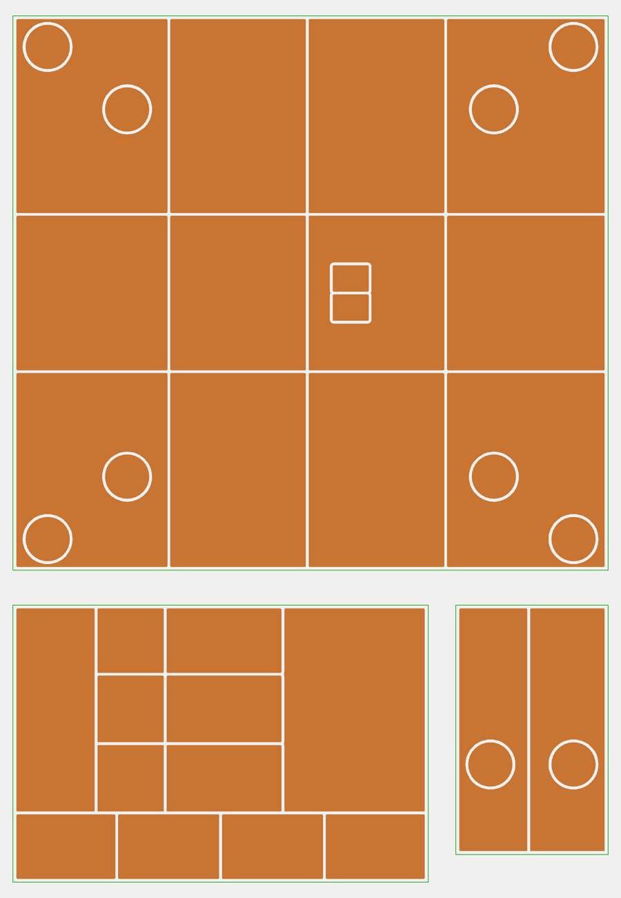
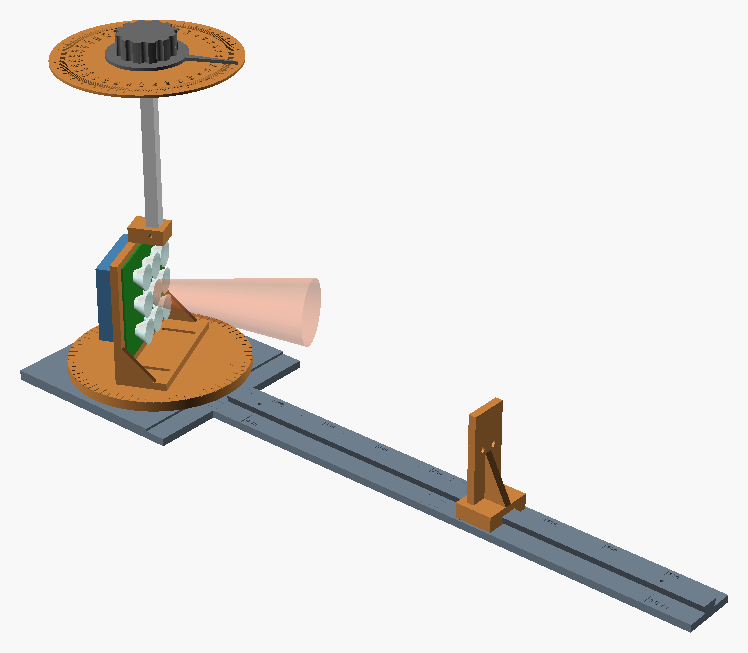

# L1: L1.11 C optic test: bench procedures, test board, rig

Package L1.11 of lane L1 (imager-09). Tests: T-UV-7 (optic 400 nm efficiency) and T-UV-6 (LED-to-optic height, beam, pointing), then C21 or C28 (imager-06 "C optic and array checks", calc §5 and §6c). This folder holds what the bench needs; the calc scripts and readings sit in `calcs/` (`l1_11_*`).

Rule for every step with a lit LED: the shroud is closed first. Read through the meter, never by eye in the beam (R9). The XL6009 check has no UV.

## 1. XL6009 bench check (no UV)

What it proves: the XL6009 module (B07XG323G8) holds 26.2 V at the C21 strings' 0.55 A from the 12 V brick for 10 min without running hot (calc §8). Readings go in `calcs/l1_11_xl6009.csv`; `python3 calcs/l1_11_xl6009.py` does the math and the pass rules.

On hand: XL6009 module, ALITOVE ALT-1205T brick, the two 24 Ω 50 W loads, Klein MM300 (one meter), Klein IR thermometer, leads.

```
 brick +12 ──(meter, 10 A jack, step 6 only)── IN+ ┌─────────┐ OUT+ ── 24 Ω ── 24 Ω ──┐
 brick GND ─────────────────────────────────── IN- │ XL6009  │ OUT- ──────────────────┘
                                                   └─────────┘
 loads screwed or clamped flat on metal; fingers off: 7.15 W each
```

1. **Cap.** Read the voltage printed on the output electrolytic (the OUT side). Pass: ≥ 35 V. → `cap_out_rating_V`.
2. **Load, cold.** Meter on 200 Ω: touch the probes together (`R_leads_ohm`), then the two loads in series (`R_load_cold_ohm`, about 48).
3. **Set point.** Brick on, no load. Meter on 200 V at OUT; trim the pot to read 26.2 (`V_out_noload_V`). Also note the brick alone on 20 V (`V_brick_noload_V`).
4. **Run.** Power off, connect the 48 Ω load (on metal), power on and start a timer. Meter stays in V mode; move the probes, not the wires:
   - 1 min: OUT on 200 V → `V_out_1min_V`. If it reads under 26.2, trim back to 26.2 now and log the trimmed value instead.
   - 2 min: IN terminals on 20 V → `V_in_2min_V`. 5 min OUT, 6 min IN, 10 min OUT and IN.
   - Watch for a dropout or the output clicking off → `dropout_or_hiccup`.
5. **Temperatures at 10 min.** IR thermometer close in, so the spot covers one part: XL6009 chip, diode, inductor, output cap, each load (the loads' shiny housing reads low: aim at a matte spot or a strip of masking tape). Room temperature at the bench. Pass: hottest module point ≤ 185 °F (85 °C) (EST, proposed).
6. **Input current.** Power off. Meter red lead to the 10 A jack, in series with IN+. Power on, read within 30 s while everything is still hot → `I_in_A`. Power off. Red lead back to the V jack before anything else.
7. Optional: the same in series with OUT+ → `I_out_A` (the script also gets it from V/R).

Expected (EST, calc §8): 0.546 A and 14.30 W out; about 1.40 A in at 12.0 V at 85 %. The meter's 10 A range is ±(3 % + 5 digits), so η comes out about ±0.07: good enough for the record, not a pass rule.

Pass (proposed; the lead confirms): cap ≥ 35 V; 26.2 V with no load; Vout at 10 min within 0.1 V of 1 min with no dropout; hottest module point ≤ 85 °C. A fail puts a CV boost on the buy list with the build optics.

## 2. Test board panel (`test_board/`)

One KiCad 7 file, three boards on one 2-sided 1.6 mm (0.063 in) 1 oz FR4 blank. Panel 86 x 125 mm (3.39 x 4.92 in). On a 4 x 5 in (101.6 x 127 mm) piece that leaves 0.31 in (7.8 mm) a side across but only 0.04 in (1 mm) a side along: (101.6 - 86)/2 and (127 - 125)/2. A 4 x 6 in (101.6 x 152.4 mm) piece leaves 0.54 in (13.7 mm) along for clamping; or cut the test board (86 x 80 mm) from one piece and the two small boards from another. Isolation-milled on the top only, 0.4 mm (15.7 mil) cuts; the bottom copper stays intact as a floating heat spreader. PCB milling on the 3018 isn't set up yet (Dallas, 2026-11-17): the Gerbers wait for it.



- `l1_11_test_board.kicad_pcb` / `.kicad_pro`, footprints in `l1_11.pretty` (project `fp-lib-table`). Regenerate: `python3 light/l1_11/test_board/make_test_board.py` (KiCad 7 pcbnew). No schematic: the board is drawn directly; nets below.
- `gerber/`: F.Cu (isolate), Edge.Cuts (cut out), PTH drill (10 x 0.126 in (3.2 mm), all unplated on a milled board), F.SilkS and F.Fab for reference. B.Cu is empty on purpose: don't mill the bottom.
- `drc_report.txt`: 0 clearance, short or unconnected errors. Left: library warnings (this sandbox has no global footprint table; they clear in your KiCad) and a few silkscreen warnings (no silk on a milled board).

**A. Test board, 86 x 80 mm (3.39 x 3.15 in).** 9 CUN0LF1B at C21's pitch, 0.787 x 0.893 in (20.00 x 22.68 mm), footprint `LED_SMD:LED_PLCC_2835_Handsoldering` (KiCad 7's stock part matches the V1 board @ 8208f05 pad for pad: large pad 1 = K at -1.05 mm, pad 2 = A at +1.525 mm). The strings are the rows, anode on the left: `VIN_Rr | D | Rr_N1 | D | Rr_N2 | D | Rr_OUT`. Each cut runs through an LED's pad gap, so every inner cathode pad sits in a 0.77 x 0.88 in (19.6 x 22.3 mm) island (119.325 - 99.725 by 111.14 - 88.86 for the center LED): most of the copper stays (L1.12 reads FR4's per-LED θ from this board). NTC TH1 (1206) sits on two isolated islands 0.20 in (5 mm) right of the center LED, beside its cathode pad, with two wire pads. No ballasts on this board: their 1.1 W typ would bias L1.12's θ. Holes: 4 x M3 on the ATS's 53.00 mm (2.087 in) square centred on the center LED, 4 x M3 on a 71.0 mm (2.795 in) square for the holder and the rig frame, so the board mounts at 0° or 90° for the two scan axes; each hole has an isolated copper ring under the screw head, so a screw can't join two nets through the ATS.

**B. Control board, 60 x 40 mm, outside the shroud.** Brick +12 V in → three VIN wires. Each string's OUT wire → a link (JP1-3: solder bridge, or clip lead; open it and clip the meter's 200 mA range across to read that string's current; leave it open to switch the string off) → ballast R1-3 → GND. Ballast footprint takes either your 12 Ω ≥ 0.61 W axial laid flat (leads bent to the outer pads) or four 47 Ω 1206 in parallel (11.75 Ω): fit one. Detector load RL across DET A+/K- (1206 or axial, 100 kΩ to start) with meter pads; NTC wire and meter pads.

**C. Detector board, 22 x 36 mm.** The spare CUN0LF1B (D10) as the detector, A+ and K- wire pads, 2 x M3 to the detector carriage.

**Before soldering: polarity.** The footprint (and V1) say the large pad is the cathode; the CUN0LF1B DS drawing isn't readable as text. Two checks, neither powers an LED:
1. Phone macro photos, sent here: a spare from the cut tape, top and bottom; one LED on the populated V1 board with both pads in view (V1 put pad 1 = K on the large pad).
2. Daylight, optional: a spare with fine wires on its pads, 1 MΩ across them, meter on 200 mV, facing a window or outside. A positive reading means the red lead is on the anode.

If the large pad turns out to be the anode, nothing changes on the board: all nine face the same way, so swap the string wires (VIN on the right pads, OUT on the left). The NTC still sits by the large (thermal) pad.

**Assembly.** LEDs from the cut tape, all the same way round (large pad right as drawn). Mill, deburr, clean; paste and hot air or a hot plate, or an iron. TH1 on its two islands; two fine wires off its wire pads, flat on the board, out past the right edge (the holder gets a groove for them). Grease on the ATS, board centred on it, 4 x M3 through the ATS's corner holes (caliper them first, and the ATS base thickness, for the screw length); nuts between the fins.

| Wire | From | To |
|---|---|---|
| VIN1-3 | control V12 pads | test board VIN1-3 (left edge) |
| OUT1-3 | test board OUT1-3 (right edge) | control S1-S3 OUT pads |
| NTC x2 | TH1 wire pads | control NTC pads |
| DET x2 | detector A+, K- | control DET A+, K- |
| Brick | +12 and GND | control +12 IN, GND IN |

At the brick's 12.0 V each string runs 125-225 mA across the Vf bins, 175 mA typ, through 12 Ω; ballast 0.61 W max (calcs/l1_c_lead_checks.py section 6, EST). With 4 x 47 Ω (11.75 Ω) the top bin reaches (12.0 - 3 x 3.1)/11.75 = 230 mA, still under the DS's 250 mA.

## 3. Rotation rig (`rig/`)

Dallas picked the turntable over the hand-moved slide (2026-11-17): the board turns under a knob on the shroud lid, the detector stays put, and the shroud never opens during a scan. The axis runs through the center optic's exit face. It replaces imager-06's linear detector scan (proposed to the lead in the packet).



`l1_11_rig.scad` (OpenSCAD 2021.01, parametric) → `sh export.sh` writes `stl/` (binary STL) and the picture. Every part fits the MK3S+ bed (250 x 210 x 210 mm); the largest is a track segment at 226 x 44 mm.

| Part | Qty | Filament | Notes |
|---|---|---|---|
| `base` | 1 | black PLA | 150 x 150 mm; pivot boss, sockets for track 1 |
| `rotor` | 1 | black PLA | Ø140 mm, rim ticks every 5°; nut traps underneath |
| `frame` | 1 | black PETG or ASA | holds the board on its 71.0 mm hole square at 0° or 90°; the ATS passes through; the top arm carries the shaft. Next to warm parts, so not PLA |
| `shaft` | 1 | any | 10 mm square, prints 6.30 in (160 mm): cut from the top end to L = box inside height + lid thickness − 99 mm |
| `knob` | 1 | any | pointer reaches the scale's ticks |
| `scale` | 1 | any | Ø140 mm, 1° ticks, labels every 10° from −170 to 180; tape it to the lid |
| `track1`, `track2` | 1 each | black PLA | dovetail rib, joined by dovetail tabs (no screws); mm from the axis engraved; detents at 4, 12 and 18 in |
| `carriage` | 1 | black PLA | rides the rib; lock screw into the detents; post for the detector board |

Black inside the shroud keeps stray UV off the detector. Prints: 0.2 mm layers, 3 perimeters, 20-30 % infill, no supports (the frame prints on its back face; the carriage upright).

**Hardware (M3, from stock; check the lengths you have):**
- Frame foot to rotor: 2 x M3 x 14, nuts in the rotor's underside. The screw tip must not stick out below the rotor.
- Board to frame: 4 x M3 x 10 with no holder (board + frame = 7.6 mm); longer once the holder goes on (its thickness comes with its drawing). Nuts in the frame's back face.
- Board to ATS: 4 x M3, length = 1.6 mm + the ATS base thickness + a nut (caliper the base).
- Shaft pin: 1 x M3 x 16 through the arm into the shaft. Knob set screw: 1 x M3 x 10.
- Carriage lock: 1 x M3 x 10 down into a detent. Detector board: 2 x M3 x 10.

**Assembly.** Base on the shroud floor. Rotor over the boss. Board plus ATS onto the frame (4 corner screws), frame onto the rotor through the foot slots: slide it until the center optic's exit face sits over the boss, then tighten. Shaft into the arm, pinned. Tracks into the base's sockets. Carriage on the rib from the far end, the detector board on its post facing the board. Lid on, knob on the shaft, set screw. With the board square to the track (rotor 0 tick at the base's index), turn the scale until the pointer reads 0 and tape it down.

**Shroud (yours to build: cardboard box or foam board).** Inside at least 24 x 12 x 8 in (610 x 305 x 203 mm): the rig runs from the base's back edge at -75 mm to the track's end at +495 mm, 570 mm, plus 10 mm at the back wall = 580 mm (22.8 in). Lid: one Ø1.42 in (36 mm) hole over the boss, 3.35 in (85 mm) from the back wall, centred across; the knob's skirt covers it. One small hole low in a side wall for the 10 wires. Matte black inside if you can: wall reflections show up as false tails in the profile. A background reading with the beam turned away (±150°) measures what's left.

**Waits for the optics.** The holder plate, the black blanks (they block a lit LED's pocket) and the 0.010 in (0.25 mm) shims. No public 20XPS drawing turned up (LEDSupply lists Ø20 x 8.5 mm only), so the holder gets drawn from calipers when they land. Measure on one optic: overall diameter and height; any rim or flange, its diameter and thickness; the bottom face diameter; the entrance cavity's diameter and depth; any legs or pins. Plus the height of a spare 3528 off the tape. A side-on and a bottom-up phone photo helps. The frame's foot slots take ±0.47 in (±12 mm) of exit-face height, so the holder can come out at whatever height the optic needs.

## 4. T-UV-7: optic efficiency at 400 nm (first; go/no-go)

Readings sheet: `calcs/l1_11_optic_readings.csv`, written in bench order by `python3 calcs/l1_11_optic_test.py --skeleton`, with every dial angle filled in. Fill only the `reading` column; `python3 calcs/l1_11_optic_test.py` does the rest (with no readings yet it runs its self-test on synthetic scans).

Method (proposed, replaces imager-06's linear scan): the board turns, the detector stays at D = 4.00 in (101.6 mm). Flux through the sphere about the axis, Φ = 2π D² ∫ E(φ) sin φ dφ, from the mean of four half-profiles (two axes, both sides). η = Φ_optic / Φ_bare, three passes. Both are integrated, so the bare LED doesn't need to be Lambertian.

1. **Setup.** Shroud closed for every reading. Detector wired to the control board's DET pads, RL = 100 kΩ across them, meter on 200 mV (2000 mV for the optic's peak). String 2 only: link S2 bridged, S1 and S3 open. That lights D4, D5 and D6; D5 is the center LED on the axis. During optic passes, D4 and D6 carry black blanks.
2. **Range check, once, before pass 1.** Optic on D5, dial at 0, LED settled (step 3). Pick RL so this peak reads 200-500 mV: start at 100 kΩ, go up if it's under 200, down if it's over 500. Above about 0.5 V the detector starts to forward-bias itself and stops being linear (EST). The bare LED then reads about 1/23 of the peak (the self-test's on-axis gain at 4 in), about 9-22 mV, still 90-220 counts on the 200 mV range. Keep that RL for the whole session: every result is a ratio.
3. **Settle.** After each power-up, wait until the on-axis reading holds within 1 % for a minute (EST 2-3 min) before scanning. Each scan starts with a dark reading (UV off).
4. **Scans** (the sheet lists every angle): bare from −85° to +85° every 5° (35 readings); optic every 1° to ±15°, 2.5° to ±40°, 5° to ±85° (69). Pass 1 does both axes (board at 0° then 90°), passes 2 and 3 the x axis: 416 readings.
5. **Result.** η ≥ 0.50 passes (EST, L1.3's low end). Under 0.50: stop and report (a UV-absorbing grade, or a poor fit on the 3528) before any T-UV-6 work.

The plans' interpolation bias on η, checked on synthetic scans: −0.04 % optic (log-linear), −0.07 % bare (linear, 5° steps). Wide angles matter more than they look, because the sin φ weight grows with angle. In the self-test's beam (15° core plus 3 % of the peak in a 50° wide tail), 14.7 % of the flux lies beyond ±21.5°, where the intensity is only 2.1 % of the peak, and 3.9 % beyond ±40° at 0.51 %. A scan stopping at ±21.5° would read η about 15 % low on that beam.

## 5. T-UV-6: height, beam, profile, pointing

1. **Height.** D = 12 in (304.8 mm), x axis, holder seated then raised 0.010 in (0.25 mm) at a time: 0, 0.25, 0.50, 0.75 mm (add 1.00 if 0.75 is still the narrowest). Each scan: on axis plus every 1° from 4° to 12° each side (19 readings). The narrowest FWHM sets the height; record it, board to optic base.
2. **Far field.** At the set height: 18 in on x, then 12 and 18 in on y (board at 90°). FWHM = 2 atan((D₂ tan φ₂ − D₁ tan φ₁)/(D₂ − D₁)) from the half-max angles φ; the difference takes out the 0.79 in (20 mm) aperture.
3. **Profile.** At the set height, 12 in, both axes: every 0.5° to ±10°, 1° to ±20°, 2.5° to ±40° (77 readings each). Gives the flux outside ±7.5° and ±15°, and the 10-90 % edge half-width at the resist (calc §5), for t = 0.0128 and 0.0285 in (0.326, 0.725 mm) until T-LCD-4 measures t. A Gaussian of 15° FWHM gives 1.22 and 2.71 mil; the script's 2D rebuild reproduces both to 0.002 mil.
4. **Pointing.** Each LED alone: its optic on, blanks on its two row-mates, its row's link bridged. 7 readings 3° apart around where its beam should land, −atan(s/D) on the dial for an LED s off the axis (±3.76° for ±0.787 in (20 mm) at 12 in). The script shift-fits the step 3 profile to them and corrects the parallax. Board at 0° for x, 90° for y: 126 readings.
5. **Background.** Once per session: the beam turned to ±150° (away from the detector), one reading. That's the box's stray light; if it's over 1 % of the peak, blacken the walls before trusting the tails.

**Bench time (EST):** T-UV-7 416 readings, T-UV-6 413, about 10 s a reading with the knob, plus about 3 min per shroud opening (holder swaps, board turns, blanks): about 1.5 h for T-UV-7 and 2.5 h for T-UV-6. Two sittings in this thread.

**C21 or C28.** The script calls it: C21 if η ≥ 0.50 and the edge half-width ≤ 2.5 mil (REQ-008) at the governing t; if it holds only at the thin t, C21 rests on T-LCD-4. Build optics for C21: 21 + 4 spares − 9 reusable test optics = 16, about $26.36 before shipping at LEDSupply's 2026-11-17 listing (EST; confirm at order).
